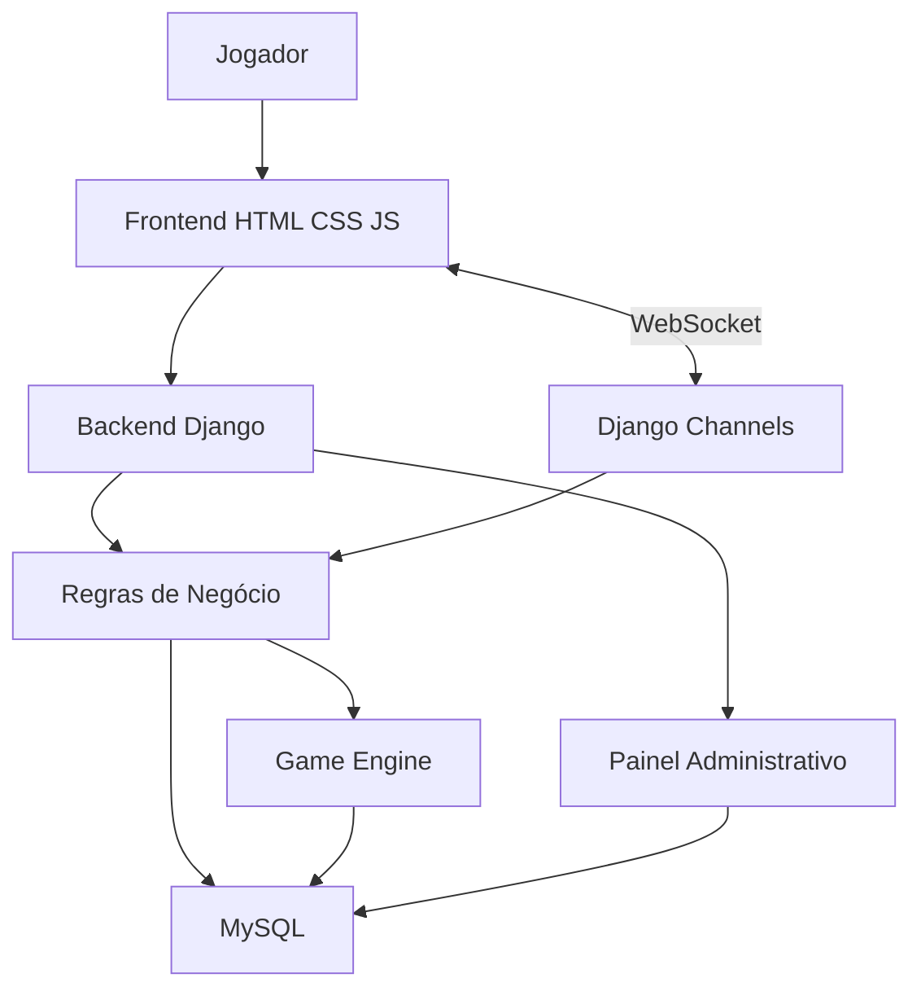

# BATTLE CARD-GAME

Jogo de cartas online 1x1 (Python · Django · Django Channels/WebSockets · MySQL · HTML/CSS/JS).
Servidor autoritativo: o navegador só envia pedidos; as regras vivem no pacote `engine/` (Python puro).

> **Leia primeiro `docs/pendencias.md`.** Nesta entrega, o motor de jogo (`engine/`) e as regras puras foram
> testados (56 testes passando). O código Django/Channels/MySQL e o frontend foram escritos, mas **não puderam ser
> executados** no ambiente de desenvolvimento (sem Django, MySQL e internet). Rode a suíte completa na sua máquina.

## Início rápido (Linux/macOS)

```bash
# 1) MySQL 8 rodando e banco criado (edite a senha em sql/00_create_database.sql antes)
mysql -u root -p < sql/00_create_database.sql
# 2) 1ª execução cria .env; edite as credenciais do banco e rode de novo
scripts/setup.sh
scripts/setup.sh --dev-data        # cria as 3 contas de teste (veja abaixo)
# 3) iniciar
scripts/start.sh                   # Daphne (HTTP + WebSocket) em http://localhost:8000
```

Windows: `scripts\setup.bat`, `scripts\start.bat`. Sem MySQL local: `docker compose up -d db` (só o banco; veja `docker-compose.yml`).

## Contas de teste (`seed_dev`)

`TesteA`, `TesteB` (jogadores) e `TesteC` (**ADMIN**, acessa `/painel/`). Senha = `SEED_TEST_PASSWORD` do `.env`.
Cada conta tem 3 decks de 40 cartas aleatórias (máx. 3 iguais por deck) e Grimorium vazio. **Não use em produção.**
Para criar um administrador real: `python manage.py createadmin NOME EMAIL`.

## Testes

```bash
scripts/run_tests.sh               # motor + regras puras (não exige Django)
scripts/run_tests.sh --django      # inclui testes Django com SQLite (exige setup)
```

## Estrutura

| Pasta | Conteúdo |
|---|---|
| `engine/` | regras do jogo em Python puro (turnos, combate, skills, projeção por jogador) |
| `apps/accounts` | Conta (modelo de usuário), cadastro, login, regras de validação |
| `apps/cards` | catálogo de cartas (banco), importação JSON/CSV, cache |
| `apps/decks` | Decks, Grimorium, deck inicial aleatório |
| `apps/game` | salas, partidas (runtime), WebSockets, histórico, recompensas |
| `apps/chat` | chat (lobby, sala, privado), limites e persistência |
| `apps/painel` | painel administrativo e monitoramento |
| `apps/core` | servidores, i18n, presença, páginas, middleware de segurança |
| `frontend/` | templates, CSS, JS (sem scripts/estilos inline) |
| `seeds/`, `sql/` | 100 cartas (JSON/CSV/SQL gerados), scripts SQL |
| `docs/` | documentação e diagramas Mermaid (`docs/diagrams/*.mmd`) |

## Documentação

`docs/arquitetura.md` · `banco.md` · `apis.md` · `websockets.md` · `regras.md` · `combate.md` · `cartas.md` ·
`instalacao.md` · `configuracao.md` · `dependencias.md` · `seguranca.md` · `manutencao.md` · `decisoes.md` · `pendencias.md`

---

**Jogo online de batalha de cartas com partidas multiplayer em tempo real.**

O **BATTLE CARD-GAME** é um projeto de desenvolvimento de um jogo digital de cartas colecionáveis, com sistema de combate estratégico, gerenciamento de decks, coleções, salas multiplayer e partidas online entre jogadores.

O projeto utiliza Python e Django no backend, HTML5, CSS3 e JavaScript no frontend, MySQL para persistência de dados e Django Channels com WebSockets para comunicação em tempo real.

O objetivo é desenvolver uma aplicação modular, segura e expansível, preservando as mecânicas definidas na documentação original do jogo.

<escape>---

</escape>

## Índice

- [Sobre o projeto](#-sobre-o-projeto)
- [Objetivos](#-objetivos)
- [Funcionalidades previstas](#-funcionalidades-previstas)
- [Mecânicas do jogo](#-mecânicas-do-jogo)
- [Tecnologias utilizadas](#-tecnologias-utilizadas)
- [Arquitetura](#-arquitetura)
- [Banco de dados](#-banco-de-dados)
- [Estrutura do projeto](#-estrutura-do-projeto)
- [Instalação e execução](#-instalação-e-execução)
- [Documentação](#-documentação)
- [Segurança](#-segurança)
- [Testes](#-testes)
- [Roadmap](#-roadmap)
- [Contribuição](#-contribuição)
- [Licença](#-licença)

---

## 🎮 Sobre o projeto

O BATTLE CARD-GAME propõe uma experiência de batalha estratégica baseada em cartas, na qual dois jogadores disputam partidas em uma arena de dimensões 5x5.

Cada jogador possui um Avatar, pontos de vida (LIFE), pontos de mana (MANA) e um conjunto de cartas que poderá utilizar durante a partida.

As cartas possuem atributos, elementos, habilidades e efeitos que influenciam diretamente as estratégias de combate.

Além das partidas, o sistema contempla gerenciamento de contas, decks, coleções, salas, comunicação entre jogadores e histórico de partidas.

O projeto será desenvolvido inicialmente como uma aplicação web, com execução local e arquitetura preparada para futura implantação online.

## 🎯 Objetivos

- Desenvolver um jogo de cartas multiplayer 1x1.
- Implementar um sistema de combate estratégico em tempo real.
- Criar um sistema de gerenciamento de cartas, decks e coleções.
- Desenvolver salas multiplayer e comunicação entre jogadores.
- Implementar mecanismos de segurança e validação no servidor.
- Construir uma arquitetura modular e extensível.
- Permitir futuras expansões de cartas, habilidades, efeitos e modos de jogo.

## 🕹️ Funcionalidades previstas

### Contas e autenticação
- Cadastro de contas.
- Login e logout.
- Gerenciamento de sessões.
- Controle de permissões.

### Sistema multiplayer
- Partidas 1x1.
- Modo de depuração individual.
- Criação e gerenciamento de salas.
- Entrada e saída de jogadores.
- Sincronização das partidas em tempo real.
- Detecção de desconexão e reconexão.

### Sistema de cartas
- Cadastro e gerenciamento de cartas.
- Cartas com diferentes elementos e atributos.
- Sistema de raridades.
- Cartas especiais Foil e Shiny.
- Habilidades e efeitos.
- Importação de cartas por JSON e CSV.

### Decks e coleções
- Gerenciamento de decks.
- Limite de 40 cartas por deck.
- Máximo de três cópias de cada carta por deck.
- Grimorium com capacidade de até 500 registros.
- Transferência de cartas entre Grimorium e Deck.

### Comunicação
- Chat global.
- Chat privado.
- Chat das salas de batalha.
- Notificações visuais.
- Convites para partidas.

### Administração e monitoramento
- Gerenciamento de contas.
- Gerenciamento de cartas e coleções.
- Consulta de históricos.
- Monitoramento de usuários conectados.
- Monitoramento de salas e partidas.
- Registros operacionais e logs.

---

## ⚔️ Mecânicas do jogo

### Arena

O combate acontece em uma arena de 5x5 posições.

Cada jogador possui um Avatar e poderá movimentar cartas, invocar criaturas e utilizar habilidades conforme as regras do jogo.

### Atributos

As partidas utilizam os seguintes atributos principais:

| Atributo | Descrição |
|---|---|
| LIFE | Pontos de vida do jogador. |
| MANA | Recurso utilizado para invocações e habilidades. |
| POWER | Poder de combate das cartas. |
| SHIELD | Proteção e defesa das cartas. |
| DAMAGE | Dano recebido pelas cartas. |
| MANA COST | Custo de mana para determinadas ações. |

### Elementos

O sistema original contempla nove elementos:

| Elemento | Código |
|---|---|
| Earth | E |
| Sorcery | S |
| Fire | F |
| Warrior | W |
| Ice | I |
| Air | A |
| Metal | M |
| Undead | U |
| Beast | B |

Cada carta poderá possuir até quatro elementos.

### Habilidades

O conjunto inicial de habilidades funcionais contempla:

- **Fire Ball:** causa dano a uma carta adversária.
- **Teleport:** permite movimentação adicional.
- **Explosion:** causa dano em uma área da arena.

### Turnos

As partidas possuem três fases:

1. START
2. ACTION
3. ENDING

Cada turno possui temporizador de 45 segundos, com mecanismos de controle de inatividade (AFK).

---

## 🛠️ Tecnologias utilizadas

| Tecnologia | Aplicação |
|---|---|
| Python | Linguagem principal do backend. |
| Django | Framework backend. |
| Django Channels | Comunicação assíncrona e multiplayer. |
| WebSockets | Comunicação em tempo real. |
| HTML5 | Estrutura das interfaces. |
| CSS3 | Estilização e responsividade. |
| JavaScript | Interatividade do frontend. |
| MySQL | Banco de dados relacional. |
| Django ORM | Mapeamento objeto-relacional. |
| Django Migrations | Versionamento da estrutura do banco. |
| Mermaid | Diagramas técnicos e documentação. |

As versões das tecnologias e dependências serão definidas durante a etapa de planejamento técnico, priorizando compatibilidade, estabilidade e segurança.

---

## 🏗️ Arquitetura

O projeto seguirá uma arquitetura modular, separando responsabilidades entre apresentação, regras de negócio, persistência e comunicação.

### Componentes principais

| Componente | Responsabilidade |
|---|---|
| Frontend | Interfaces e interação com o jogador. |
| Backend | Processamento das requisições e regras de negócio. |
| Game Engine | Execução das regras e mecânicas de combate. |
| Database | Persistência de contas, cartas, decks e partidas. |
| Multiplayer | Gerenciamento de salas e comunicação em tempo real. |
| Administration | Gerenciamento administrativo do sistema. |
| Monitoring | Monitoramento operacional e registros. |

### Fluxo de comunicação



O servidor será responsável pela validação das ações e pelo controle oficial do estado das partidas. O cliente não poderá modificar diretamente variáveis críticas do jogo.

---

## 🗄️ Banco de dados

O banco de dados principal será MySQL.

A estrutura será gerenciada por meio das migrations do Django, com scripts SQL complementares para inicialização e operações administrativas.

### Entidades principais

| Entidade | Responsabilidade |
|---|---|
| Conta | Dados e informações dos jogadores. |
| Deck | Cartas utilizadas nas partidas. |
| Grimorium | Coleção de cartas dos jogadores. |
| Historico_Partida | Registro dos eventos das partidas. |
| Card | Cadastro e atributos das cartas. |
| Sala | Gerenciamento das salas multiplayer. |
| Partida | Estado e informações dos duelos. |

Outras entidades poderão ser criadas durante a modelagem técnica para representar habilidades, efeitos, mensagens, combinações e demais componentes.

---

## 📁 Estrutura do projeto

A organização definitiva será estabelecida durante o planejamento técnico. A estrutura conceitual prevista é:

```text
BATTLE_CARD_GAME/
│
├── backend/
│   ├── config/
│   ├── accounts/
│   ├── cards/
│   ├── decks/
│   ├── grimorium/
│   ├── battles/
│   ├── multiplayer/
│   ├── chat/
│   ├── administration/
│   └── monitoring/
│
├── frontend/
│   ├── html/
│   ├── css/
│   ├── js/
│   └── assets/
│
├── database/
│   ├── sql/
│   └── seed/
│
├── documentation/
│   ├── architecture/
│   ├── database/
│   ├── api/
│   ├── gameplay/
│   └── diagrams/
│
├── scripts/
│   ├── windows/
│   └── linux/
│
├── tests/
│
├── .env.example
├── .gitignore
├── requirements.txt
└── README.md
```

---

## 💻 Instalação e execução

> **Status:** as instruções definitivas de instalação serão adicionadas após a implementação e validação do ambiente de desenvolvimento.

O ambiente deverá contemplar:

- Python.
- Django.
- MySQL.
- Dependências do projeto.
- Configurações de ambiente.
- Serviços necessários para comunicação multiplayer.

### Preparação do ambiente

Após a disponibilização do código-fonte:

1. Clone o repositório.
2. Configure o ambiente Python.
3. Instale as dependências.
4. Configure o banco MySQL.
5. Crie o arquivo `.env`.
6. Execute as migrations.
7. Carregue os dados iniciais.
8. Inicie os serviços do projeto.

Os comandos específicos e os scripts de inicialização para Windows e Linux serão documentados conforme a implementação definitiva.

### Configuração das variáveis de ambiente

O projeto disponibilizará um arquivo `.env.example` com as variáveis necessárias.

Crie uma cópia chamada `.env` e configure as credenciais locais.

Nunca compartilhe credenciais reais ou publique o arquivo `.env`.

---

## 📚 Documentação

A documentação técnica será organizada em arquivos Markdown.

| Documento | Conteúdo |
|---|---|
| README.md | Apresentação e instruções gerais. |
| ARCHITECTURE.md | Arquitetura e organização do sistema. |
| DATABASE.md | Estrutura e relacionamentos do banco. |
| API.md | Endpoints e contratos de comunicação. |
| WEBSOCKETS.md | Comunicação em tempo real. |
| GAME_RULES.md | Regras e mecânicas do jogo. |
| CARDS.md | Estrutura e gerenciamento das cartas. |
| INSTALLATION.md | Instalação e configuração. |

Os diagramas técnicos serão desenvolvidos utilizando Mermaid.

---

## 🔐 Segurança

A aplicação deverá utilizar mecanismos de segurança compatíveis com aplicações web modernas.

Entre as medidas previstas:

- Hash seguro de senhas.
- Validação de informações no backend.
- Proteção contra SQL Injection.
- Proteção contra XSS.
- Proteção contra CSRF.
- Controle de autenticação e autorização.
- Validação de ações multiplayer no servidor.
- Proteção das conexões WebSocket.
- Gerenciamento seguro de sessões.

O servidor será a autoridade sobre as regras e os resultados das partidas.

---

## 🧪 Testes

Serão realizados testes básicos para verificar:

- Inicialização do Django.
- Funcionamento do backend.
- Conexão com MySQL.
- Carregamento das principais páginas.
- Configuração dos serviços.
- Ausência de erros críticos de inicialização.

Os resultados dos testes serão documentados, distinguindo funcionalidades implementadas, parcialmente implementadas e pendentes.

---

## 🗺️ Roadmap

O desenvolvimento será organizado nas seguintes etapas:

- [ ] Análise completa da especificação original.
- [ ] Planejamento da arquitetura.
- [ ] Modelagem do banco de dados.
- [ ] Configuração do ambiente.
- [ ] Implementação de contas e autenticação.
- [ ] Implementação do sistema de cartas.
- [ ] Implementação de decks e Grimorium.
- [ ] Implementação da arena e mecânicas de combate.
- [ ] Implementação do multiplayer.
- [ ] Implementação de salas e chat.
- [ ] Implementação do histórico de partidas.
- [ ] Implementação da administração.
- [ ] Implementação do monitoramento.
- [ ] Testes e correções.
- [ ] Documentação técnica.
- [ ] Empacotamento e entrega do projeto.

---

## 🤝 Contribuição

Contribuições poderão ser realizadas futuramente, respeitando:

- A arquitetura estabelecida.
- As regras originais do jogo.
- Os padrões de código.
- A documentação técnica.
- Os mecanismos de segurança.

Alterações nas regras de negócio e mecânicas de combate deverão ser avaliadas antes de serem incorporadas.

---

## 📄 Licença

A licença do projeto deverá ser definida antes de sua distribuição pública.

Até essa definição, todos os direitos sobre o código, documentação e recursos originais permanecem reservados aos respectivos titulares.

---

## 📌 Status do projeto

**Em fase de planejamento e desenvolvimento.**

Este repositório representa o projeto BATTLE CARD-GAME e sua especificação técnica. As funcionalidades descritas como previstas não devem ser consideradas implementadas até que sejam efetivamente desenvolvidas e verificadas.

**BATTLE CARD-GAME — Estratégia, cartas e batalhas em tempo real.**
