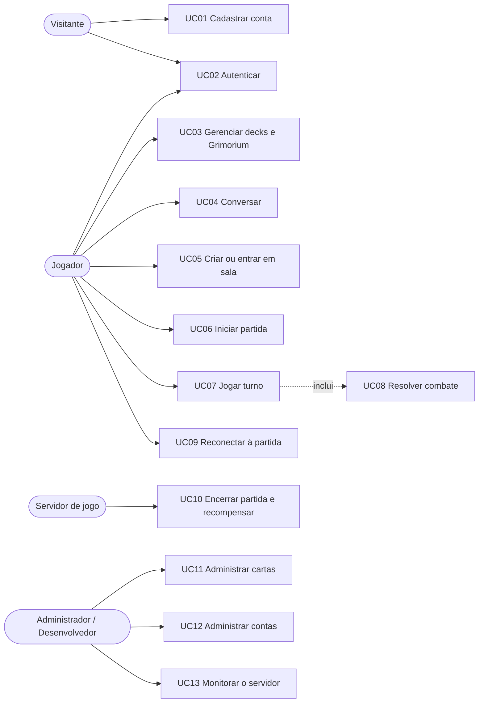

# 3. Casos de Uso — BATTLE CARD-GAME

Os casos de uso referenciam os requisitos do documento `02_requisitos_RF_RNF.md` (RFxx / RNFxx).

---

## A. Atores

| Ator | Tipo | Descrição | Permissões |
|---|---|---|---|
| **Visitante** | Primário | Pessoa sem sessão. Acessa a página inicial, cria conta e faz login. | Páginas públicas, cadastro, login |
| **Jogador** | Primário | Conta autenticada com perfil `GREEN` (ou `GRAY`). Usa lobby, chat, salas, decks e partidas. | Tudo do jogo; sem painel |
| **Jogador A / Jogador B** | Primário | Papéis de um Jogador dentro de uma sala: A é o dono da sala; B é quem entra depois. | Conforme o papel na sala |
| **Adversário** | Secundário | O outro Jogador da mesma partida. Suas ações alteram o estado e geram notificações. | — |
| **Administrador** | Primário | Conta `ADMIN`. Opera o painel: contas, cartas, decks, histórico, configurações e monitor. | Painel (sem alterar contas privilegiadas) |
| **Desenvolvedor** | Primário | Conta `DEV`. Tudo do Administrador, mais alterar perfis privilegiados. | Painel completo |
| **Servidor de jogo (Sistema)** | Secundário/interno | Executa temporizadores (X/O, turno, reconexão), sorteios, arbitragem das regras e conclusão da partida. | — |
| **Banco de dados MySQL** | Secundário/externo | Persiste contas, decks, cartas, histórico e chat. | — |

### Mapa de casos de uso por ator

---

## B. Descrição dos casos de uso

Convenção: **FP** = fluxo principal; **FA** = fluxo alternativo; **FE** = fluxo de exceção.

---

### UC01 — Cadastrar conta

| Campo | Conteúdo |
|---|---|
| Ator principal | Visitante |
| Requisitos | RF01, RF02, RF07, RNF15 |
| Pré-condições | Visitante sem sessão; catálogo de cartas carregado no banco |
| Pós-condições (sucesso) | Conta criada com perfil `GREEN`, `acc_status = 1`, Deck 1 com 40 cartas e Grimorium vazio |
| Pós-condições (falha) | Nada é gravado |

**Fluxo principal**
1. O Visitante abre "Criar conta".
2. Informa nome, senha, repetição da senha e e-mail.
3. Durante o preenchimento, o sistema valida o formato no cliente e consulta a disponibilidade de nome e e-mail.
4. O Visitante envia o formulário.
5. O servidor revalida todas as regras e a unicidade.
6. O servidor grava a conta com a senha em hash e gera o Deck 1 (40 cartas, máx. 3 iguais, sem Foil/Shiny) e o Grimorium vazio, em uma única transação.
7. O sistema confirma a criação e direciona ao login.

**Fluxos alternativos**
- **FA1 — Nome ou e-mail já em uso (passo 3):** o sistema exibe "já em uso" e mantém o formulário; o envio permanece possível apenas após correção.
- **FA2 — Voltar:** o Visitante retorna à página inicial sem criar conta.

**Fluxos de exceção**
- **FE1 — Dados inválidos (passo 5):** resposta 422 com mensagens por campo (nome fora de 4–16 caracteres ou com caracteres especiais; senha fora de 6–32; senhas diferentes; e-mail sem `@` ou sem `.` após o `@`).
- **FE2 — Concorrência:** outro cadastro ocupa o mesmo nome entre a checagem e a gravação; a transação é revertida e o sistema informa "nome ou e-mail já cadastrado".
- **FE3 — Catálogo insuficiente:** menos de 14 Card_ID disponíveis impedem gerar o deck inicial; a conta não é criada e o sistema orienta a executar o *seed* de cartas.
- **FE4 — Excesso de requisições de checagem:** acima de 30 por minuto por IP, o sistema responde "muitas tentativas".

---

### UC02 — Autenticar (login e logout)

| Campo | Conteúdo |
|---|---|
| Ator principal | Visitante / Jogador |
| Requisitos | RF03, RF04, RF05, RF06, RNF15, RNF18 |
| Pré-condições | Conta existente |
| Pós-condições | Sessão ativa (login) ou encerrada (logout); sessões anteriores da mesma conta derrubadas |

**Fluxo principal**
1. O Visitante informa nome e senha em "Entrar".
2. O sistema verifica o limite de tentativas e valida as credenciais (nome sem diferenciar maiúsculas).
3. O sistema cria a sessão, registra o último login e encerra qualquer sessão anterior da conta, incluindo conexões WebSocket.
4. O Jogador é direcionado à seleção de servidor.

**Fluxos alternativos**
- **FA1 — Logout:** o Jogador seleciona "Sair"; a sessão é destruída e ele retorna à página inicial.
- **FA2 — Login em outro dispositivo:** a sessão antiga é encerrada e a conexão WebSocket antiga é fechada com código 4000; o cliente antigo é redirecionado ao login.

**Fluxos de exceção**
- **FE1 — Credenciais inválidas:** mensagem genérica "nome ou senha inválidos" (sem indicar qual está errado).
- **FE2 — Conta bloqueada (`RED`):** o login é recusado com a mesma mensagem genérica.
- **FE3 — Limite excedido (10 tentativas em 5 minutos por IP e nome):** resposta "muitas tentativas"; o contador é zerado após login bem-sucedido.
- **FE4 — Acesso a página protegida sem sessão:** redirecionamento ao login.

---

### UC03 — Gerenciar decks e Grimorium

| Campo | Conteúdo |
|---|---|
| Ator principal | Jogador |
| Requisitos | RF20, RF21, RF22, RF23, RNF06 |
| Pré-condições | Jogador autenticado |
| Pós-condições | Decks/Grimorium atualizados respeitando os limites; deck selecionado definido |

**Fluxo principal (mover carta)**
1. O Jogador abre "Decks"; o sistema exibe os 6 slots e o Grimorium.
2. Seleciona um slot de deck.
3. Clica em uma carta (ou arrasta) para movê-la entre o deck selecionado e o Grimorium.
4. O servidor trava o destino, valida os limites e move a cópia atomicamente.
5. A tela é atualizada com as contagens (ex.: 39/40; Grimorium 1/500).

**Fluxos alternativos**
- **FA1 — Criar deck:** em slot vazio e liberado, o Jogador cria um deck vazio.
- **FA2 — Renomear deck:** informa um nome de 1 a 32 caracteres.
- **FA3 — Selecionar deck:** define o deck usado nas partidas.
- **FA4 — Remover deck:** permitido somente se estiver vazio.
- **FA5 — Mover entre dois decks:** mesma validação do destino.

**Fluxos de exceção**
- **FE1 — Deck cheio (40):** movimento recusado com "o deck já tem 40 cartas".
- **FE2 — Quarta cópia do mesmo Card_ID no deck:** recusado ("máximo de 3 cartas iguais por deck").
- **FE3 — Grimorium cheio (500):** recusado.
- **FE4 — Slot 4–6 sem premium:** slot bloqueado.
- **FE5 — Carta de outra conta ou inexistente:** recusado como "carta não encontrada".
- **FE6 — Remover deck com cartas:** recusado.

---

### UC04 — Conversar (lobby, sala e privado)

| Campo | Conteúdo |
|---|---|
| Ator principal | Jogador |
| Requisitos | RF10, RF11, RF12, RF17, RF19, RNF23 |
| Pré-condições | Jogador conectado ao lobby ou à sala |
| Pós-condições | Mensagem entregue e persistida |

**Fluxo principal**
1. O Jogador digita uma mensagem (até 126 caracteres) e escolhe o destino (Todos, ou um usuário online).
2. O servidor valida o texto, aplica a limitação de taxa e persiste a mensagem.
3. O servidor entrega a mensagem com hora local do servidor e nome do remetente aos destinatários (lobby, sala ou os dois participantes do privado).

**Fluxos alternativos**
- **FA1 — Chat da sala:** dentro da sala, a mensagem vai somente aos ocupantes.
- **FA2 — Chat privado:** o destino é um usuário online selecionado na lista.

**Fluxos de exceção**
- **FE1 — Mensagem vazia ou acima de 126 caracteres:** recusada com mensagem de erro.
- **FE2 — Mais de 5 mensagens em 5 segundos:** recusada ("muitas tentativas").
- **FE3 — Destinatário privado offline:** recusado ("usuário não está online").
- **FE4 — Caracteres de controle:** removidos antes de enviar; conteúdo exibido sempre como texto (sem interpretar HTML).

---

### UC05 — Criar ou entrar em sala

| Campo | Conteúdo |
|---|---|
| Ator principal | Jogador (A ao criar; B ao entrar) |
| Requisitos | RF09, RF13, RF14, RF15, RF16, RF18 |
| Pré-condições | Jogador no lobby e fora de qualquer sala |
| Pós-condições | Jogador alocado em uma sala; lista de salas atualizada para todos |

**Fluxo principal (criar)**
1. O Jogador informa nome da sala (1–24 caracteres), modo (1x1 ou Debug) e senha opcional.
2. O sistema cria a sala em estado ABERTA com o Jogador como A.
3. O Jogador é levado à tela da sala; o lobby passa a listar a sala.

**Fluxo principal (entrar)**
1. O Jogador escolhe uma sala ABERTA na lista (ou busca por ID).
2. Se houver senha, informa-a.
3. O sistema aloca o Jogador como B, muda a sala para READY (dois jogadores) e notifica os ocupantes.

**Fluxos alternativos**
- **FA1 — Entrar por convite:** o convite recebido leva o Jogador diretamente à tentativa de entrada (a senha continua exigida).
- **FA2 — Sala Debug:** aparece na lista como não clicável; nunca recebe segundo jogador.
- **FA3 — Sair da sala:** se A sai e B está presente, B passa a ser A; sem ocupantes, a sala é removida.
- **FA4 — Convidar:** o dono da sala aberta convida um usuário online.

**Fluxos de exceção**
- **FE1 — Sala inexistente, cheia, em batalha ou Debug:** recusado ("não é possível entrar").
- **FE2 — Senha incorreta:** recusado.
- **FE3 — Jogador já está em outra sala:** recusado.
- **FE4 — Nome de sala inválido:** recusado.
- **FE5 — Convite sem sala aberta ou alvo offline:** recusado.
- **FE6 — Jogador desconectado da sala por mais de 30 s fora de partida:** o sistema o remove da sala.

---

### UC06 — Iniciar partida (READY e escolha X/O)

| Campo | Conteúdo |
|---|---|
| Ator principal | Jogador A e Jogador B |
| Ator secundário | Servidor de jogo |
| Requisitos | RF24, RF25, RF26, RF27, RF46 |
| Pré-condições | Sala com os jogadores conectados e deck selecionado com 40 cartas |
| Pós-condições | Partida em andamento, turno 1 iniciado pelo jogador sorteado |

**Fluxo principal (1x1)**
1. Cada Jogador clica em READY; o servidor valida o deck selecionado (exatamente 40 cartas).
2. Com ambos READY e conectados, o servidor carrega os decks e o catálogo, embaralha os decks, posiciona os Avatares e distribui 5 cartas a cada um.
3. O sistema abre a janela de 10 segundos para escolha de X ou O.
4. Cada Jogador escolhe um símbolo (uma única vez).
5. O servidor resolve os símbolos, sorteia o símbolo de iniciativa e anuncia quem começa.
6. O servidor inicia o turno 1 do jogador sorteado e arma o temporizador de 45 s.

**Fluxos alternativos**
- **FA1 — Modo Debug:** apenas o dono dá READY; símbolos e iniciativa são definidos automaticamente; um único usuário controla os dois lados.
- **FA2 — Apenas um jogador escolhe:** o outro recebe o símbolo restante ao fim dos 10 s.
- **FA3 — Nenhum escolhe:** sorteio dos símbolos.
- **FA4 — Cancelar READY:** o Jogador pode desfazer o READY antes de a partida iniciar.

**Fluxos de exceção**
- **FE1 — Deck inválido (≠ 40 cartas ou inexistente):** READY recusado com a contagem atual.
- **FE2 — Escolher símbolo já escolhido pelo adversário, ou escolher duas vezes:** recusado.
- **FE3 — Jogador desconecta antes de iniciar:** o READY não inicia a partida; se desconectar na fase X/O, a partida é cancelada sem pontos.
- **FE4 — Falha ao carregar decks/catálogo:** o READY de ambos é desfeito e o erro é exibido na sala.

---

### UC07 — Jogar turno

| Campo | Conteúdo |
|---|---|
| Ator principal | Jogador (do turno) |
| Atores secundários | Adversário, Servidor de jogo |
| Requisitos | RF28–RF41 |
| Pré-condições | Partida em andamento e é o turno do Jogador |
| Pós-condições | Estado atualizado; turno passa ao adversário ou partida termina |

**Fluxo principal**
1. **START:** o servidor compra cartas até a mão ter 5 (DECK BURN se faltar carta) e inicia o contador de 45 s.
2. O Jogador seleciona uma carta (da mão, do tabuleiro ou o Avatar); os blocos válidos são destacados e o adversário vê a seleção sem ver cartas ocultas.
3. O Jogador executa ações, em qualquer ordem, respeitando os limites do turno:
   1. **Andar com o Avatar** (1 vez);
   2. **Invocar** uma carta da mão (1 vez; 2 com DOUBLE CAST pagando 1 MANA);
   3. **Mover** cartas do tabuleiro (1 por carta; nunca no turno da invocação);
   4. **Usar skill** (1 por carta; carta face-up; não no turno da invocação nem após mover/atacar).
4. A cada ação, o servidor valida, aplica, resolve efeitos (UC08) e envia a cada jogador sua visão atualizada.
5. O Jogador clica em "Encerrar turno".
6. **ENDING:** se o Avatar não andou, o jogador ganha +1 MANA (máx. 6); o turno passa ao adversário.

**Fluxos alternativos**
- **FA1 — Fim automático:** quando todas as ações possíveis se esgotam, o servidor encerra o turno.
- **FA2 — Tempo esgotado:** aos 45 s o servidor encerra o turno; se o Jogador não fez ação alguma, o contador AFK sobe; ao agir, volta a zero.
- **FA3 — Desmarcar:** clique direito cancela a seleção (e o modo de escolha de alvo de skill).
- **FA4 — Invocação face-down:** a carta é posta sem revelar nem cobrar MANA; o custo é cobrado ao revelar.
- **FA5 — Skill com alvo:** Fire Ball exige escolher uma SUMMON adversária face-up; Teleport e Explosion são imediatas.
- **FA6 — Modo Debug:** o mesmo usuário joga os turnos dos dois lados.

**Fluxos de exceção** (a ação é recusada e **nada muda**; o jogador recebe a mensagem)
- **FE1 — Não é seu turno** ou fase inválida.
- **FE2 — Bloco inválido** (fora do alcance ou da arena); avatar sobre carta adversária; mover para o próprio Avatar.
- **FE3 — Limite excedido:** segunda invocação sem DOUBLE CAST; Avatar já andou; carta já se moveu.
- **FE4 — Cooldown:** mover ou usar skill no turno da invocação.
- **FE5 — MANA insuficiente** para DOUBLE CAST ou skill.
- **FE6 — Tipo de carta ainda não implementado** (SPELL, EQUIPMENT, ITEM, FIELD, CURSE).
- **FE7 — Invocação sobre o Avatar adversário com LIFE maior que o Power** da carta.
- **FE8 — Mover sobre carta própria sem combinação cadastrada.**
- **FE9 — Skill:** carta face-down, alvo inválido ou skill já usada.
- **FE10 — Comando desconhecido ou rajada de comandos acima do limite** (40 por 5 s).

---

### UC08 — Resolver combate (incluído por UC07)

| Campo | Conteúdo |
|---|---|
| Ator | Servidor de jogo |
| Requisitos | RF35, RF36, RF37, RF42 |
| Gatilho | Mover ou invocar sobre bloco com carta adversária (ou Avatar), ou uso de skill ofensiva |

**Fluxo principal (carta contra carta)**
1. O servidor revela o alvo (se face-down) e cobra seu MANA COST; depois revela o atacante e cobra o dele.
2. Calcula o dano: `max(0, Power efetivo do atacante + Attack_Bonus − Shield do alvo)` e soma ao `damage` do alvo.
3. Calcula o contra-ataque: `max(0, Power do alvo − Shield do atacante)` e soma ao `damage` do atacante.
4. Aplica o MANA GAIN do atacante pelos elementos do alvo (limite 0–6).
5. Cartas com Power efetivo ≤ 0 são destruídas e vão ao descarte; o dano excedente atinge o LIFE do dono da carta destruída; cada destruição rende +1 Magicdust ao autor.
6. Se o atacante sobreviveu e o alvo foi destruído, o atacante ocupa o bloco do alvo.
7. O servidor verifica o fim da partida (LIFE ≤ 0).

**Fluxos alternativos**
- **FA1 — Alvo é o Avatar:** o LIFE do dono perde Power efetivo + Attack_Bonus; sem MANA GAIN; o atacante permanece onde está.
- **FA2 — Empate de Power:** as duas cartas são destruídas.
- **FA3 — Alvo sobrevive:** o atacante por movimento permanece onde estava; o atacante invocado da mão é descartado (suposição documentada).
- **FA4 — Skill ofensiva:** dano de skill ignora Shield e não transborda ao LIFE (exceto Explosion no Avatar, que reduz LIFE direto).

**Fluxos de exceção**
- **FE1 — MANA insuficiente ao revelar:** a carta é descartada, o dono perde LIFE igual ao déficit e **não há combate** (se o alvo for o descartado, o bloco fica livre).
- **FE2 — LIFE de ambos ≤ 0 na mesma ação:** empate.

---

### UC09 — Reconectar à partida

| Campo | Conteúdo |
|---|---|
| Ator principal | Jogador |
| Requisitos | RF45, RNF34 |
| Pré-condições | Partida em andamento; conexão do Jogador caiu |
| Pós-condições | Jogador volta à partida com o estado atual |

**Fluxo principal**
1. O servidor detecta a queda, avisa o adversário e abre uma janela de 120 s; os temporizadores continuam.
2. O cliente reconecta automaticamente (espera crescente) e solicita sincronização.
3. O servidor cancela a contagem de desconexão, avisa o adversário e reenvia o estado da sala e da partida.

**Fluxos alternativos**
- **FA1 — Atualizar a página (F5):** equivale à reconexão.
- **FA2 — Turnos passados durante a queda:** contam para o AFK normalmente.

**Fluxos de exceção**
- **FE1 — Janela de 120 s expira:** o Jogador perde por desconexão (0 BP) e o adversário recebe 10 BP.
- **FE2 — Sessão substituída por novo login:** a conexão antiga é fechada (código 4000) e o cliente é levado ao login.
- **FE3 — Servidor reiniciado:** a partida em memória é perdida (limitação aceita).

---

### UC10 — Encerrar partida e conceder recompensas

| Campo | Conteúdo |
|---|---|
| Ator principal | Servidor de jogo |
| Ator secundário | Banco de dados MySQL; Jogadores |
| Requisitos | RF42, RF43, RF44, RF47, RF48 |
| Gatilho | LIFE ≤ 0, AFK, abandono ou desconexão expirada |

**Fluxo principal**
1. O servidor define o resultado (vitória, derrota ou empate) e o motivo, e cancela temporizadores.
2. Calcula as recompensas: vitória por LIFE +100 BP / derrota +50 BP; empate +25 BP cada; Magicdust +1 por carta destruída; `victory_counts` +1 ao vencedor.
3. Em uma transação, grava o histórico (cabeçalho e eventos) e atualiza as contas.
4. Envia o resultado e as recompensas aos Jogadores, que voltam à sala (estado READY ou ABERTA, com READY zerado).

**Fluxos alternativos**
- **FA1 — AFK, abandono ou desconexão:** vencedor +10 BP, perdedor 0 BP.
- **FA2 — Modo Debug:** histórico gravado; nenhuma recompensa.
- **FA3 — Partida cancelada na fase X/O:** resultado "cancelada"; sem pontos.

**Fluxos de exceção**
- **FE1 — Falha ao gravar no banco:** o erro é registrado em log; os Jogadores recebem o resultado mesmo assim (sem recompensa persistida).

---

### UC11 — Administrar cartas

| Campo | Conteúdo |
|---|---|
| Ator principal | Administrador / Desenvolvedor |
| Requisitos | RF49, RF50, RF51, RF56, RF57 |
| Pré-condições | Autenticado com perfil `ADMIN` ou `DEV` |

**Fluxo principal (importar)**
1. O administrador abre Painel → Cartas → Importar e envia um arquivo JSON ou CSV, escolhendo se atualiza cartas existentes.
2. O sistema valida cada carta (Card_ID ≥ 1, tipo, atributos, até 4 elementos, até 4 MANA GAIN entre −3 e +3, até 3 skills).
3. Cria ou atualiza as válidas, invalida o cache do catálogo e exibe o relatório (criadas, atualizadas, ignoradas, duplicadas e erros por linha).

**Fluxos alternativos**
- **FA1 — Criar/editar uma carta pelo formulário.**
- **FA2 — Exportar** o catálogo em JSON.
- **FA3 — Remover carta** não utilizada.

**Fluxos de exceção**
- **FE1 — Arquivo ilegível ou sem formato válido:** rejeitado com mensagem.
- **FE2 — Card_ID 0, duplicado no arquivo ou atributos fora de faixa:** linha ignorada e listada no relatório.
- **FE3 — Remover carta em uso em decks/Grimorium:** recusado.
- **FE4 — Usuário sem perfil administrativo:** acesso negado (403) ou redirecionado ao login.

---

### UC12 — Administrar contas

| Campo | Conteúdo |
|---|---|
| Ator principal | Administrador / Desenvolvedor |
| Requisitos | RF52, RF53 |

**Fluxo principal**
1. O administrador busca uma conta por nome ou e-mail.
2. Edita perfil (`acc_code`), premium, contadores e, opcionalmente, define uma nova senha (6–32 caracteres).
3. O sistema salva (a nova senha vira hash).

**Fluxos alternativos**
- **FA1 — Bloquear conta:** alterar para `RED`; o login é recusado a partir daí.
- **FA2 — Consultar decks, Grimoriums e histórico** da conta.

**Fluxos de exceção**
- **FE1 — `ADMIN` tenta alterar ou conceder perfil `DEV`/`ADMIN`:** recusado (somente `DEV`).
- **FE2 — Senha fora das regras:** recusada.

---

### UC13 — Monitorar o servidor

| Campo | Conteúdo |
|---|---|
| Ator principal | Administrador / Desenvolvedor |
| Requisitos | RF55, RNF04, RNF30 |

**Fluxo principal**
1. O administrador abre o painel inicial; o navegador abre a conexão de monitoramento.
2. A cada 2 s o servidor envia: usuários online, conexões, salas, partidas ativas, totais e os erros recentes.
3. A tela atualiza os indicadores e tabelas.

**Fluxos alternativos**
- **FA1 — Queda do monitor:** a página tenta reconectar a cada 3 s.

**Fluxos de exceção**
- **FE1 — Usuário sem perfil administrativo:** conexão recusada (código 4403).

---

## C. Rastreabilidade casos de uso × requisitos

| Caso de uso | Requisitos |
|---|---|
| UC01 | RF01, RF02, RF07 |
| UC02 | RF03, RF04, RF05, RF06 |
| UC03 | RF20–RF23 |
| UC04 | RF10–RF12, RF17, RF19 |
| UC05 | RF09, RF13–RF16, RF18 |
| UC06 | RF24–RF27, RF46 |
| UC07 | RF28–RF34, RF36, RF38–RF41 |
| UC08 | RF35–RF37, RF42 |
| UC09 | RF45 |
| UC10 | RF42–RF44, RF47, RF48 |
| UC11 | RF49–RF51, RF56, RF57 |
| UC12 | RF52, RF53 |
| UC13 | RF54, RF55 |
